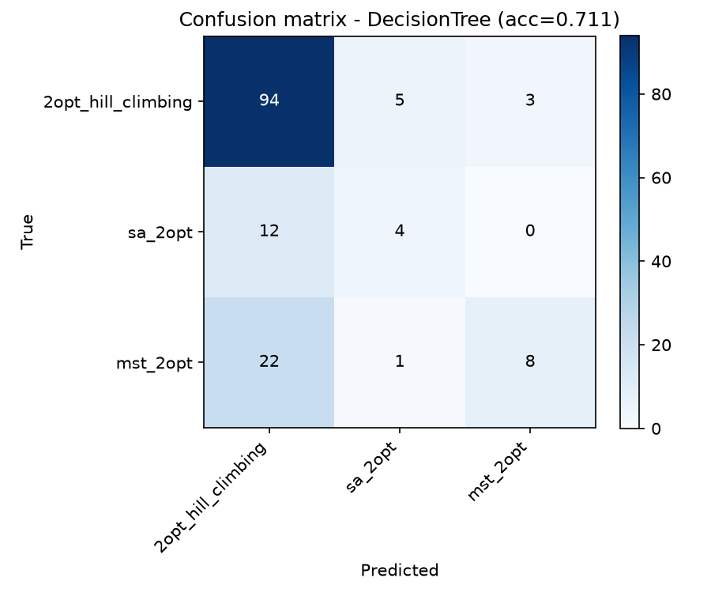

# Hiper-heurística de selección para TSP


**Curso:** Algoritmia y Optimización

**Alumno:** Luis Daniel Salazar Sanchez

**Matrícula:** 2222332

**Repositorio:** [https://github.com/WinAndronuX/algoritmia-y-optimizacion-pia](https://github.com/WinAndronuX/algoritmia-y-optimizacion-pia)


## 1. Algoritmos de Tarea 2 y parámetros

Los tres algoritmos se implementaron en `src/algorithms.py` y se corrieron sobre las
500 instancias para generar las etiquetas.

- **Búsqueda local (2-opt hill climbing).** Solución inicial por vecino más cercano;
  búsqueda local 2-opt hasta óptimo local, con cálculo incremental del delta
  (O(1) por movimiento). Determinista.
- **Recocido simulado + 2-opt.** Solución inicial por vecino más cercano;
  temperatura inicial $T_0 = 15.0$; enfriamiento geométrico con $\alpha = 0.995$;
  iteraciones = max(500, 150·n); temperatura mínima 1e-9. Semilla derivada del
  `instance_id` para que el resultado sea reproducible. $T_0 = 15.0$ se eligió por
  coherencia con el $T^* \approx 15.46$ obtenido en la Tarea 3 mediante RSM (n = 15).
- **MST + 2-opt.** Árbol de expansión mínima (Prim), recorrido preorder por DFS,
  seguido de 2-opt hasta óptimo local. Determinista.

Empates en `best_algorithm`: se resuelven a favor del primer algoritmo en el orden
fijo `2opt_hill_climbing`, `sa_2opt`, `mst_2opt` (Python conserva el orden de
inserción en `min`).

Las instancias están en [0,1]$^2$, así que los costos son directamente comparables
entre distribuciones.

## 2. Parte 1: generación de etiquetas

Para cada `instance_id` de `train.csv` y `test.csv` se cargaron las coordenadas
desde `data/instances/<instance_id>.csv` y se corrieron los tres algoritmos,
registrando `cost_2opt_hill_climbing`, `cost_sa_2opt`, `cost_mst_2opt` y
`best_algorithm` (el de menor costo). El resultado está en
`results/train_labeled.csv` y `results/test_labeled.csv`.

El script completo es `src/label.py` y tarda unos 7 segundos para las 500
instancias, porque 2-opt usa el delta incremental en lugar de recalcular el tour
completo.

## 3. Balance de clases (etiquetas propias)

Sobre las 500 instancias:

| Algoritmo | Ganador (total) | Train (351) | Test (149) |
|---|---|---|---|
| 2opt_hill_climbing | 68.6 % | 68.7 % | 68.5 % |
| mst_2opt | 20.2 % | 20.2 % | 20.8 % |
| sa_2opt | 11.1 % | 11.1 % | 10.7 % |

La clase dominante es `2opt_hill_climbing`, así que el baseline trivial es
"predecir siempre 2opt_hill_climbing", con accuracy 0.6846 en el conjunto de
prueba. Este número es el que hay que superar, no un valor fijo del enunciado.

## 4. Parte 2: Machine Learning

### 4.1 Features

Se usaron las características provistas (`n`, `distribution`,
`mean_pairwise_dist`, `std_coords`, `mean_centroid_dist`, `mean_nn_dist`), con
`distribution` codificada con one-hot. No se calcularon features adicionales.

### 4.2 Modelos y métricas

| Modelo | Hiperparámetros | Accuracy (test) | vs. baseline | Regret medio |
|---|---|---|---|---|
| Baseline (mayoría) | — | 0.6846 | — | — |
| Árbol de decisión | max_depth=5, min_samples_leaf=20 | **0.7114** | +0.0268 | 0.0314 |
| KNN | k = 15 | 0.6913 | +0.0067 | 0.0423 |
| Random Forest | 200 árboles | 0.6577 | -0.0268 | 0.0380 |

El árbol de decisión es el mejor modelo y supera al baseline por 2.7 puntos.

### 4.3 Matriz de confusión (árbol de decisión, conjunto de prueba)

```
                predicho
              2opt  sa  mst
real 2opt      94   5    3
     sa         12   4    0
     mst        22   1    8
```



### 4.4 Regret

Para cada instancia de prueba se calculó
costo(algoritmo elegido por el modelo) - costo(mejor algoritmo real).
El regret medio del mejor modelo es 0.0314, es decir, cuando el modelo se
equivoca el costo extra del tour es pequeño.

### 4.5 Importancia de características

Árbol de decisión: `n` (0.30), `std_coords` (0.24), `mean_nn_dist` (0.20),
`mean_pairwise_dist` (0.15), `distribution_border` (0.08),
`distribution_uniform` (0.03). `mean_centroid_dist` y `distribution_clustered`
tienen importancia cercana a cero.

Random Forest coincide en el orden relativo: `mean_nn_dist` (0.22),
`mean_pairwise_dist` (0.20), `mean_centroid_dist` (0.20), `std_coords` (0.20),
`n` (0.15); las distribuciones aportan poco ($\le$ 0.01).

## 5. Análisis

**¿Identifica las instancias donde SA o MST+2opt superan a 2-opt, o colapsa?**
El árbol supera al baseline y sí captura casos minoritarios: recall de
`mst_2opt` = 0.26 y de `sa_2opt` = 0.25. Pero la mayoría de las predicciones
siguen siendo `2opt_hill_climbing`, lo que refleja el desbalance (68/20/11).
No colapsa totalmente, pero tampoco detecta bien la clase minoritaria
`sa_2opt`.

**Patrón por tamaño y distribución.** Para n > 25 con `std_coords` bajo el
modelo tiende a predecir `mst_2opt`; para n pequeño y distribuciones uniforme o
clustered predice `2opt_hill_climbing`. `sa_2opt` aparece en instancias
pequeñas (n $\le$ 12--15) con `std_coords` alto y distancias medias bajas, lo que
concuerda con que el recocido simulado ayuda en paisajes de costo más rugosos.
Las distribuciones por sí solas aportan poca información (importancia $\le$ 0.08);
el tamaño `n` y la dispersión de los puntos (`std_coords`, `mean_nn_dist`) son
los que mejor discriminan.

**Límite del enfoque.** Con solo cuatro características numéricas más `n` y la
distribución, la señal para distinguir algoritmos es débil y el desbalance de
clases (68/20/11) dificulta la detección de `sa_2opt`. Aun así, el regret medio
es bajo (0.0314), así que los errores del modelo cuestan poco en calidad del
tour.
